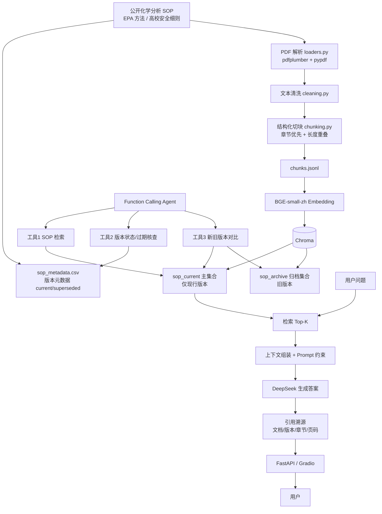

# 系统架构 — ChemLab SOP Copilot

## 全链路流程

## 要点说明

- **双集合隔离**：current 进 `sop_current`，superseded 进 `sop_archive`；默认问答只检索 current，从机制上避免引用过期版本。
- **Agent 三工具**：SOP 检索走向量库；版本核查走元数据表；版本对比同时读取两个集合。
- **密钥不落地**：DeepSeek Key 仅通过环境变量注入，代码仓库与镜像均不含真实密钥。